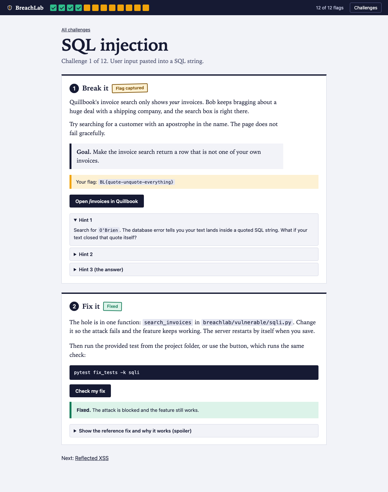

# BreachLab

Learn web security by breaking a small, realistic app and then fixing it, entirely on your own machine.
Ten guided challenges, each with a story, three hints, automatic flag detection, and a test that only passes once you have closed the hole.

> [!CAUTION]
> **BreachLab is vulnerable on purpose. Never deploy it, never expose it to a network.**
> It binds to `127.0.0.1` only, refuses any other bind address, and rejects requests that do not come
> from and for your own machine. Keep it that way: do not put it behind a proxy, a tunnel or a container port mapping.


## Quickstart

You need Python 3.10 or newer and git. The only runtime dependency is Flask.

```bash
git clone https://github.com/Habibeyilmazz/breachlab.git
cd breachlab
python3 -m venv .venv
source .venv/bin/activate
pip install -r requirements-dev.txt
python -m breachlab
```

Open <http://127.0.0.1:4160/> and pick a challenge. Sign in to the practice app as `alice` / `alice-demo`.

Developed and tested on macOS and Linux. Windows is untested.

## How a challenge goes

**1. Break it.** Each challenge page tells a short story about Quillbook, the fake notes-and-invoices
app, and states a goal. Attack the app in your browser (or with curl). Three hints are there if you get
stuck; the third one is the answer. When the attack works, the lab notices by itself and shows your flag.


**2. Fix it.** The hole is always in one small function under `breachlab/vulnerable/`. Open the file
named on the challenge page, patch the function, and run the provided test in a second terminal
(the server keeps running in the first; activate the virtual environment there too):

```bash
source .venv/bin/activate
pytest fix_tests -k sqli
```

The test replays the attack (with a few variations) and also checks that the feature still works, so
deleting the feature does not count as a fix. The "Check my fix" button on the challenge page runs the
same check. The server restarts by itself when you save a file.



Stuck on the fix? Every challenge has a reference fix in `breachlab/solutions/`, with an explanation of
why the hole existed, why the fix works, and the general pattern to use in real code. The challenge
page can show it (behind a spoiler), and `python -m breachlab --fixed` runs the whole app on the
reference fixes so you can watch your attacks fail.

## The ten challenges

| # | Challenge | Where in Quillbook | Function you patch |
|---|-----------|--------------------|--------------------|
| 1 | SQL injection | Invoice search | `sqli.search_invoices` |
| 2 | Reflected XSS | Help centre search | `reflected_xss.results_heading` |
| 3 | Stored XSS | Team board | `stored_xss.render_note` |
| 4 | Insecure direct object reference | Invoice page | `idor.load_invoice` |
| 5 | Path traversal | Invoice export download | `path_traversal.export_path` |
| 6 | Open redirect | Login `next` parameter | `open_redirect.redirect_target` |
| 7 | Mass assignment | Account profile form | `mass_assignment.profile_changes` |
| 8 | Cross-site request forgery | Account profile form | `csrf.is_request_genuine` |
| 9 | Forged JWT (`alg: none` and a weak secret) | API token | `weak_jwt.verify` |
| 10 | Server-side request forgery | Import invoice from URL | `ssrf.is_allowed_url` |

## Features

- Ten challenges with a story, a goal, three progressive hints and a flag each.
- Automatic detection: the server recognises a successful attack (a foreign row in search results, a
  read outside the exports folder, a forged admin token, script calling `alert()`, and so on). There
  is no flag form to paste into.
- A fix stage per challenge: a marked function, a provided test, a "Check my fix" button, and a
  reference fix that explains itself.
- A progress page showing which holes you have broken and which you have fixed, also visible as a
  strip of ten squares in the bar above every page.
- Reset buttons: restore the sample data (keeps your flags), or wipe data and progress.
- `--fixed` mode to run the app on the reference fixes.

## How it works

```
breachlab/
  app.py           Quillbook (the fake app) and the lab pages, one Flask app
  vulnerable/      ten small modules, one deliberately vulnerable function each  <- you edit these
  solutions/       the same ten functions, fixed, with the explanation in the docstring
  checks.py        per challenge: replay the attack, then check the feature still works
  challenges.py    stories, goals, hints
  store.py         throwaway SQLite data and progress
fix_tests/         the provided tests (red until you fix the hole)
tests/             the lab's own test suite
e2e/solve.cjs      solves every challenge in a real browser (Playwright)
```

`app.py` never contains a hole itself. Each route calls into one function from `vulnerable/` (or
`solutions/` with `--fixed`), which is what makes a challenge patchable in one place and testable in
both states.

Data is throwaway: two small SQLite files and a few text files in `.breachlab/` inside the checkout,
created on first start. Delete the folder or use the reset buttons at any time.

### Safety rails

These are part of the lab, not part of any challenge:

- **Loopback only.** `--host` accepts `127.0.0.1`, `localhost` and `::1`; anything else, such as
  `python -m breachlab --host 0.0.0.0`, exits with an error. Independently of how the
  server was started, every request is refused unless the client address is loopback and the `Host`
  header is `127.0.0.1`, `localhost` or `[::1]`. The Host check also blocks DNS rebinding from a
  hostile website open in the same browser.
- **No outbound connections.** The SSRF challenge is real from the learner's side, but the "fetch" is
  sandboxed: a URL that points back at the lab is dispatched in-process, and anything else gets a
  notice instead of a request. The lab cannot be used to reach your network. One caveat: a correct
  SSRF fix has to resolve the host name it is given, so with the reference fix (or your own) a DNS
  lookup for the name you typed can leave your machine. No HTTP request ever does.
- **Fenced file access.** The path traversal hole can leave the `exports` folder, but the lab only
  ever serves files from its own `.breachlab/files/` folder. An attempt to read `/etc/passwd` still
  captures the flag, and gets an explanation instead of the file.
- **Lab actions are same-origin.** Reset, "Check my fix" and the XSS beacon reject posts from other origins.

The rails limit what a mistake can cost; they do not make the app safe. Stop the server when you are not practising.

## Tests

```bash
pytest                                   # the lab's own suite, green on a clean checkout
BREACHLAB_IMPL=solutions pytest fix_tests  # the provided tests against the reference fixes
```

The suite proves, for each of the ten challenges, that the attack succeeds and the flag is captured
on the vulnerable code, that the reference fix blocks the attack while the feature keeps working, and
that fixing one challenge alone turns its test green. The checks are tested too: a set of plausible
half-fixes (escaping only the first quote, stripping only `<script>` tags, refusing only loopback
addresses, and so on) must fail them, and sound alternative fixes must pass. The suite also covers the
safety rails above.

Script execution for the two XSS challenges cannot be observed without a browser, so pytest proves
them by the payload arriving unescaped in the HTML. `e2e/solve.cjs` covers the rest of the way: it
drives Chromium through all ten exploits against a running server and, with `MODE=fixed`, checks that
they all fail on the reference fixes. CI runs both.

```bash
cd e2e && npm install && npx playwright install chromium && cd ..
python -m breachlab --no-reload &
node e2e/solve.cjs          # wipes lab progress first; uses port 4161 for the attacker page
```

## Known limits

- XSS flags are detected when your payload calls `alert()`, `confirm()` or `prompt()`. Script that
  runs without calling one of them is a working exploit the lab will not notice.
- The fix checks replay a fixed list of attack variations. Passing them means the known attacks fail,
  not that the code is proven secure.
- The JWT challenge covers `alg: none` and a guessable HS256 secret. RS256/HS256 key confusion is
  explained in the reference fix but not playable (it needs RSA, and the lab has no crypto dependency).
- On the open redirect challenge, backslash tricks such as `/\evil.example` do not work as attacks
  here because Werkzeug percent-encodes them. The fix test still requires your code to reject them.
- One learner per checkout: progress is global, not per user.

## Roadmap

- A built-in attacker page helper for the CSRF challenge (today you start `python3 -m http.server` yourself).
- A playable RS256/HS256 key confusion challenge.
- More bug classes: command injection, XXE, insecure deserialization, race conditions, clickjacking.
- A defence-in-depth stage per challenge (Content-Security-Policy, cookie flags, framework CSRF protection).
- Verified Windows support.

## License

MIT, see [LICENSE](LICENSE).
